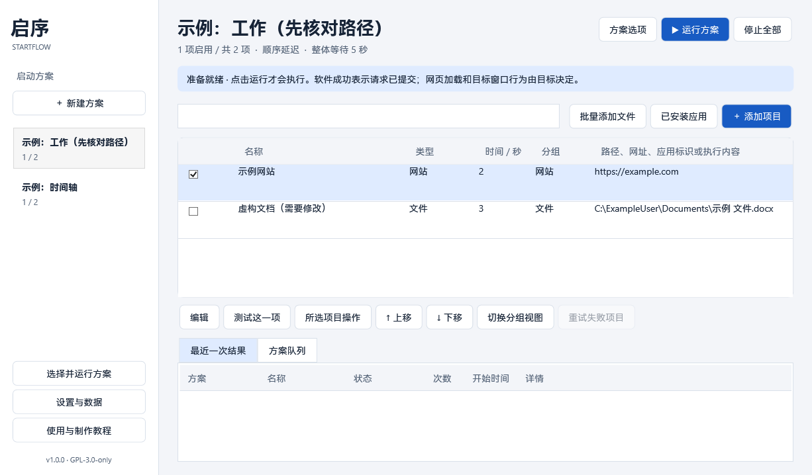
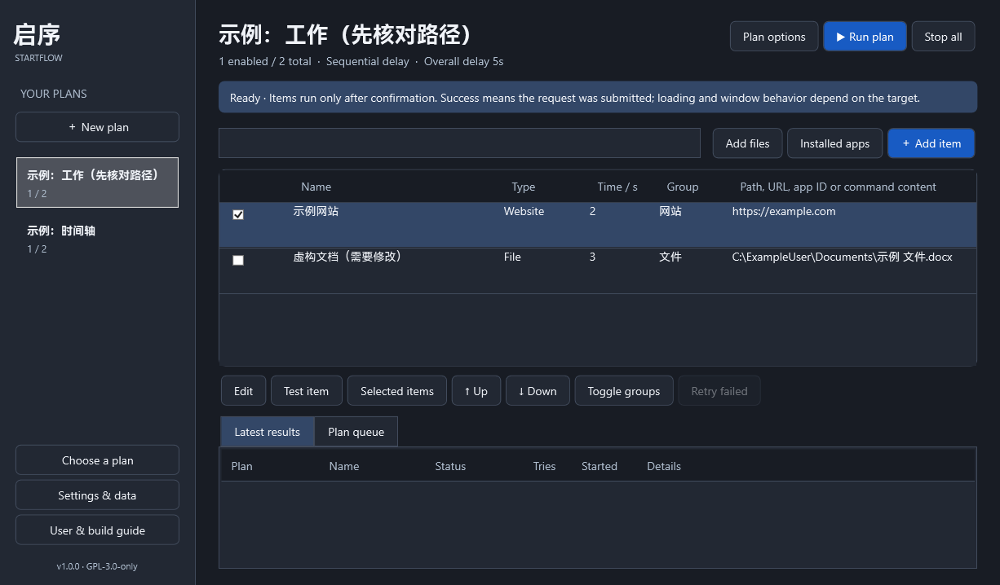

# 启序 · StartFlow：零基础使用与制作教程

适用：Windows 11 x64，首版 1.0.0。软件不要求账号，不后台检查更新。下文菜单名称以简体中文界面为准。

## 1. 下载与选择版本

打开 [StartFlow 官方仓库](https://github.com/you2032zhu/StartFlow)，点击右侧 **Releases**，打开最新版本，在 **Assets** 下载附件。也可直接打开 [下载页](https://github.com/you2032zhu/StartFlow/releases/latest)。自行构建的本地成品位于项目文件夹的 `artifacts`。

| 文件 | 适合谁 | 如何使用 |
|---|---|---|
| `StartFlow-1.0.0-win-x64-Setup.exe` | 希望有开始菜单快捷方式 | 双击安装，按提示接受 GPL 许可，安装到当前用户目录 |
| `StartFlow-1.0.0-win-x64-Portable.zip` | 希望整个目录可移动 | 右键压缩包 → 全部解压 → 选择有写入权限的文件夹 → 解压后双击 StartFlow.exe |
| `StartFlow-1.0.0-Source.zip` | 希望自行修改和制作 | 这是源码，先阅读后面的制作部分 |

两种成品均自带 .NET，普通用户无需安装 SDK 或运行时。便携版不能直接在压缩包中运行，也不能只复制 exe。请完整保留 DLL、Resources、portable.flag 等文件。不要放进 `Program Files` 这类普通用户不可写位置。

程序和安装包没有真实代码签名证书。Windows 的信誉提示不代表已经做过安全认证；确认下载来源、核对校验值和源码后自行决定是否运行，不要关闭系统安全功能。

安装版默认位置：`%LOCALAPPDATA%\Programs\StartFlow`。在资源管理器地址栏输入这个目录可打开。数据位置：`%LOCALAPPDATA%\StartFlow`。便携版数据位置：程序旁的 `Data`。应用内“设置与数据 → 打开本地数据目录”可以直接打开正在使用的目录。

## 2. 第一次建立方案

1. 打开启序，点击左侧 **＋ 新建方案**。
2. 输入例如“工作”，点击 **保存**。左侧出现方案名及 `启用数 / 总数`。
3. 点击 **＋ 添加项目**，填写名称和类型，再填写目标。
4. 点击 **保存**。此时只保存，不运行。
5. 在顶部点击 **▶ 运行方案** 才开始执行。

下面是此软件实际运行时使用示例配置的界面渲染（不含系统标题栏；示例路径为虚构，未运行）：





软件不附带真实用户的软件路径，也不会第一次打开就替你启用登录启动。

## 3. 添加不同目标

### 桌面软件

推荐点击 **已安装应用**，等待列表读取完毕，在搜索框输入软件名，选中后点击添加，核对编辑窗口再保存。列表包含开始菜单快捷方式、商店应用和安装记录。安装记录如果没有可靠启动入口，会明确提示手动选择，不会把卸载命令当成启动命令。

也可以点 **批量添加文件**，在文件选择器中按住 Ctrl 选多个 `.exe` 或快捷方式，再点打开。单个项目用“浏览并选择目标”也可以。手动填写完整路径时，路径字段本身不用包外层引号，例如 `C:\Program Files\Example\Example.exe`。参数单独放到高级选项。

### 桌面快捷方式

把桌面的 `.lnk` 拖到启序主窗口。程序读取目标、参数、工作目录和图标信息并放入备注，实际运行原快捷方式，以保留其 shell 语义。通常无需再次把快捷方式里的参数填到高级参数，以免追加两次。

### Microsoft Store 应用

点击 **已安装应用**，选择对应条目。类型应为“商店应用”，目标是类似 `包家族名!应用标识` 的 AUMID。不要从受保护的 WindowsApps 文件夹复制某个版本的 exe 路径。商店应用窗口由目标决定，最大化/最小化可能不适用。

### 网站

添加项目 → 类型“网站” → 输入 `https://example.com`。必须使用有效的 `http://` 或 `https://`，漏写时保存会给出修正建议。默认浏览器处理网址；未联网时仍直接尝试打开。

多个网站通常由浏览器分配为标签页，但浏览器自身设置决定最终窗口，启序无法跨全部浏览器保证同一窗口。浏览器已经运行也不会跳过网站项目。结果“请求已提交”不代表加载完成、联网成功或登录成功。启序不收集历史、不探测网站加载、不填写或保存密码。

### 文件与文件夹

文件类型选择“文件”，选文档、图片或项目文件，由 Windows 默认关联打开。文件夹类型选择“文件夹”，点击浏览选择文件夹，由资源管理器打开。没有文件关联时 Windows 可能要求你选择打开方式。

### 脚本

类型“脚本文件”，选 `.ps1`、`.bat` 或 `.cmd`。PowerShell 使用系统 Windows PowerShell 与 `-File`；批处理使用系统 cmd。遵守 Windows 执行策略，不自动使用 Bypass。受策略限制时请理解脚本来源，并按照组织或系统正常管理流程处理。

### 直接命令

类型“直接命令”，明确选择 **Windows PowerShell** 或 **cmd.exe**。目标框填写该解释器理解的执行内容。安全入门例子：PowerShell 填写 `Write-Output 'Hello StartFlow'`。不要把普通程序路径拼成 shell 命令，普通程序应选“桌面软件”。保存、导入和预览都不会执行命令。

Cmd 中的 `&`、`|`、`>`、`%` 等有解释器含义，参数引号遵循 cmd 本身规则；复杂内容建议保存为经过检查的脚本，或使用 PowerShell。不要在参数、网址、备注或命令中保存账号密码、令牌。

## 4. 排序、分组、批量与窗口状态

点击项目行后可编辑，或双击该行。按 Ctrl / Shift 多选，点击“所选项目操作”可启用、停用、复制、移动到其他方案、设置分组或删除。删除会确认，只删配置条目，不删引用文件。

拖动项目行可调整真实执行顺序，也可单选后用“↑ 上移 / ↓ 下移”。先清空搜索并关闭分组视图再排序，以免把筛选显示顺序误当作执行顺序。分组由每个项目的“分组”文本决定；“切换分组视图”只改变展示，实际列表顺序仍可在关闭分组后查看。

同一方案加入同类型、规范化目标和关键参数相同的项目时会询问是否继续；不同方案允许复用同一目标。复制项目也会确认。

编辑窗口可选正常、最大化、最小化。这是给目标的建议，不是强制控制；浏览器、单实例应用或某些 Store 应用会忽略。第一版不定位多显示器窗口。

高级选项默认折叠：启动参数、工作目录、管理员权限、运行检测信息和图标来源。请求管理员权限只针对这一项，不会让整个启序始终以管理员运行。取消 UAC 会显示已取消，不反复自动提权。

默认普通应用按完整进程路径检查是否已运行；Store 应用按标识。不同参数可能代表不同任务，带参数时若没有明确进程身份，不会盲目据名称跳过。权限无法读取进程时会如实提示并尝试启动。只有明确需要时填写“进程名”，它是用户主动选择的名称匹配，可能误判同名程序。网站、文件、文件夹、快捷方式、脚本和命令不套用普通软件去重。

## 5. 两种时间模式实例

点击 **方案选项 → 重命名与时间设置**。

**顺序延迟**：整体等待 5 秒，A 的时间 2 秒，B 的时间 3 秒。确认运行后约第 7 秒提交 A，A 请求返回后再等 3 秒提交 B。不会等 A 的窗口出现或加载完成。操作系统/UAC 提交请求耗时可能使实际时刻后移。

**统一时间轴**：整体等待 5 秒，A 计划 2 秒、B 计划 3 秒。到期分别为参考起点后第 7、8 秒，整体时间只加一次。手动运行的参考起点是确认运行时刻；登录流程的参考起点是启序登录入口被触发时刻，不是精确系统登录时间。

如果登录入口 09:00:00 被触发，用户 09:01:00 才点运行，7 秒和 8 秒的项目都已到期，此时按列表顺序尽快提交，每项一次。用户点运行前绝不执行。同一未来时刻的项目按列表顺序提交；不同未来时刻按到期先后处理。

## 6. 登录启动

1. 点击 **设置与数据 → 常规与登录启动**。
2. 勾选 **登录 Windows 后启动启序**，点击保存。
3. 再打开这个设置页，查看实际系统入口与当前程序路径是否一致。
4. 下次真正退出登录再登录，启序显示方案选择窗口，列出数量和上次方案，可展开看项目。先选方案，再点运行，或点“本次跳过”。不操作会一直等。

关闭开关再保存会删除真实当前用户启动入口并验证。无需整机管理员权限。Windows 可以自行延迟启动应用；如果提示在系统“启动应用”中被禁用，请打开 Windows 设置 → 应用 → 启动，找到 StartFlow 并自行开启。启序不会擅自覆盖 Windows 的禁用选择。

便携版移动后：先手动打开新目录里的 StartFlow → 常规与登录启动 → 检查旧路径 → 点击“修复为当前程序路径”。移动前先关闭登录启动也可以。安装版升级会修复确实属于旧安装目录的入口；不会抢占已指向其他便携副本的入口。两版共用一个正式 StartFlow 登录入口，请只选一个常用副本。

普通双击只打开管理界面，已有托盘实例会被唤起，不会再建调度器。睡眠唤醒和解锁不会重新执行登录流程。同一次登录里重启启序，也不会重复触发已经处理的登录流程。

## 7. 托盘与下次跳过

第一次关主窗口会询问“最小化到托盘”或“退出”，可勾“记住选择”。以后在常规设置中重新修改。托盘图标可能位于任务栏右下角向上箭头中。

右键托盘可打开管理、选择运行、下次登录跳过一次、停止或退出。双击图标打开管理。“下次登录跳过一次”只影响下一次新的登录；本次会话重启软件不消费，实际用于下一次登录后清除。设置中可提前取消。

退出会取消未执行任务、重试和队列，保留已经打开的软件、网页和文件。请从托盘“退出”后再升级或卸载。不要靠任务管理器结束正在写配置的程序。

## 8. 队列、失败、重试和停止

运行期间选另一套方案会入队，最多等待 20 套；同一套已在运行或排队时会提示，防止误触无限排队。入队保存的是当时快照，编辑原方案不改变队列。前一套所有项目及其重试完成后才开始下一套。

某项失败不会中断后续项目。项目编辑 → 展开“失败重试”，设置额外次数和间隔。等待重试不会挪动后续计划；成功后不再重试。管理员请求被用户取消时不自动重试。

“停止全部”取消未来项目、延迟、重试和队列；不会杀死已创建的进程。脚本可能继续运行，但启序不再等待其结果。已经弹出的 Windows UAC 请求无法安全撤销，请自行取消/完成，启序等正在提交的请求返回后才结束停止；不要理解为停止可以撤回已经发给 Windows 的请求。

“最近一次结果”只在内存中显示最近一套：等待、提交中、请求已提交、跳过、命令运行中、退出成功、失败或取消。次数包括首次尝试。普通程序快速退出不被简单判为失败。脚本与命令有句柄时观察真实退出码；0 通常为成功，非 0 显示失败并可按设置重试。“重试失败项目”会把最近失败条目快照作为新方案任务排队。

选一行 → “测试这一项”会确认后真实运行。失效路径请选该行 → 编辑 → 浏览重新定位。保存不存在的路径会再次提示。浏览器成功仅说明提交请求，网页加载失败请查看浏览器。

## 9. 导出、导入与换电脑

导出：设置与数据 → 预览并导出全部配置 → 阅读/编辑 JSON → 保存 → 选择你自己的备份目录。预览可删除或替换私人路径、网址、命令和备注，但要保持合法格式；不懂 JSON 时可取消，先在项目编辑窗口修改后再导出。不要把唯一备份放在程序数据目录里。

导入：设置与数据 → 导入全部配置 → 选择 `.json` → 检查每个目标和管理员选项 → 选择合并或替换。合并给导入项目新 ID，重名方案加编号；替换前保存 `config.json.before-import-时间` 备份。导入不执行，也不会自动启用登录启动。

换电脑后路径可能不同，预览会标记无效目标，导入后逐项编辑修正。Store 标识也应在新电脑重新核对。配置版本不支持或格式不合法时拒绝导入，不会硬改。原文件损坏时可以确认从备份恢复；损坏原件另存 recovery 文件。取消恢复会退出，以便你先复制原文件求助。

## 10. 卸载与便携版移除

安装版：先导出到安全目录 → 托盘退出 → Windows 设置 → 应用 → 安装的应用 → StartFlow → 卸载。提示会说明默认删除自己的配置；需要先备份就点取消。卸载只删程序、自己的配置族文件和属于该安装路径的启动值；不删引用的软件/文件，也不删无关导出文件。

便携版：先在常规设置中关闭登录启动并保存 → 从托盘退出 → 删除整个便携文件夹（包含 Data）。若备份放在里面，先移到外部目录。已丢失便携目录时，可通过 Windows 设置禁用旧启动项，或请熟悉注册表的人删除 HKCU Run 下名为 StartFlow 的旧值；不要删除其他应用的启动值。

升级：先导出备份并退出旧程序。安装版直接运行新版安装包，不先卸载。便携版用新包覆盖程序文件、保留原 `Data`，不要把旧包的 DLL 与新包混杂；更稳妥的是解压新目录，再复制 Data 并修复启动路径。

## 11. 常见问题

- **没弹选择窗口**：检查登录启动开关、实际路径、Windows 启动应用禁用状态、是否开启下一次跳过。用 `--login` 是开发测试入口，不是平时打开方式。
- **软件重复打开**：检查目标类型和参数。快捷方式/网站等没有普通进程去重；某些启动器自身退出并派生其他进程，可在高级选项写实际进程路径。
- **窗口状态没生效**：目标忽略启动建议，不代表启序已强制设置。无需为此关闭系统保护。
- **便携保存失败**：完整解压到你可写的目录，检查磁盘空间、只读属性；启序不会偷偷改到另一处保存。
- **中文或空格路径**：路径放目标框；参数里的文件路径按目标软件语法加引号，例如 `--file "C:\工作 文件\计划.txt"`。不要用拼接 shell 命令替代普通 exe 启动。
- **杀毒/信誉提示**：当前没有签名证书。核对官方发布来源和 SHA-256，不要全局关闭防护。公开发布前应在干净 Windows 虚拟机复测。
- **卸载提示仍在运行**：关主窗口可能只是到托盘，右键托盘 → 退出后再卸载。

## 12. 从零安装开发工具

这里只是自己制作时需要；使用成品可跳过。

1. 打开微软官方 [.NET 10 下载页](https://dotnet.microsoft.com/download/dotnet/10.0)，选择 **SDK 10.0.402 → Windows x64**。不要只下载 Runtime。安装后重新打开终端。
2. 可选安装 Visual Studio（选择支持 .NET 10 的版本和“.NET 桌面开发”工作负载）；不装 IDE 也能使用下面命令构建。编辑源码可用 VS Code 或 Visual Studio。
3. 安装 [Git for Windows](https://git-scm.com/download/win)，供 GitHub Desktop 或命令行使用；也可以只用 GitHub Desktop。
4. 从 [Inno Setup 官方发行](https://github.com/jrsoftware/issrc/releases/tag/is-7_1_0) 下载 7.1.0 x64，记住 `ISCC.exe` 安装位置。项目也提供会校验哈希及签名的 `scripts/Get-InnoSetup.ps1`，装到 `.tools/inno`，无需整机管理员安装。

## 13. 获得源码、打开终端和编译

1. 把 Source.zip 全部解压到例如 `D:\StartFlow-source`（示例盘符可换）。应看到 `StartFlow.sln`、src、tests、scripts、LICENSE 等。
2. 在这个文件夹空白处右键 → **在终端中打开**。若打开的是命令提示符，输入 `powershell` 后回车，进入 PowerShell。
3. 每次只复制代码框中命令，不复制提示符。输入后按回车，等待结束：

```powershell
dotnet --version
dotnet restore StartFlow.sln
dotnet build StartFlow.sln -c Release -m:1
```

预期版本为 10.0.402 或兼容补丁，最后看到“已成功生成 / Build succeeded”，0 错误。若“找不到 dotnet”，重新打开终端；确认装的是 SDK x64。若 global.json 指定 SDK 不存在，请安装该版本，不要改成预览版凑数。还原失败时检查到 NuGet 的网络/代理，不要从不可信网站下载 DLL。

运行程序：

```powershell
dotnet run --project src/StartFlow.App -c Release
```

这会使用安装版的数据目录。开发测试想隔离数据：

```powershell
dotnet run --project src/StartFlow.App -c Release -- --test-data .test-data/manual
```

测试入口不会使用正式启动键值。它仍然是真实程序，运行项目仍会真实启动目标。

执行测试：

```powershell
powershell -NoProfile -File scripts/Build.ps1 -WindowsIntegration
```

预期每项打印 PASS，最后报告通过数量；失败退出码不为 0。它是项目自带的无依赖测试执行器，不使用 `dotnet test`。可控时钟不会长时间等待；Windows 集成测试创建并清理唯一命名启动项及临时脚本。不要把测试未报错理解为所有真实登录/浏览器组合已经验收。

若 Windows 阻止你运行下载的 PowerShell 脚本，确认来源和代码后，右键脚本 → 属性 → 若有“解除锁定”则按正常系统方式处理，或逐条运行里面已理解的命令。不要全局关闭执行策略。

## 14. 生成自包含便携版

仍在源码根目录终端输入：

```powershell
powershell -NoProfile -File scripts/Publish.ps1 -SkipInstaller
```

第一次需要下载微软运行时包。预期在 `artifacts` 看到发布文件夹、`…-Portable` 文件夹及 `…-Portable.zip`。ZIP 里面有 portable.flag，用户无需 .NET。打开解压后的 exe 并添加临时方案，确认旁边 Data 中确实生成 config.json。不要把自己的 Data 一起公开打包。

## 15. 制作安装包

方法一，使用项目下载脚本：

```powershell
powershell -NoProfile -File scripts/Get-InnoSetup.ps1
powershell -NoProfile -File scripts/Publish.ps1 -InnoCompiler ".tools\inno\ISCC.exe"
```

方法二，已自行安装 Inno Setup：将下面路径换成你电脑的实际 ISCC.exe：

```powershell
powershell -NoProfile -File scripts/Publish.ps1 -InnoCompiler "C:\你的 Inno 安装目录\ISCC.exe"
```

预期得到 `artifacts\StartFlow-1.0.0-win-x64-Setup.exe`。ISCC 不存在时脚本会明确失败，不会把 ZIP 假称安装包。安装包只面向 Windows 11 x64，无需整机提权，不自动注册登录启动。

生成相应完整源码包：

```powershell
powershell -NoProfile -File scripts/SourceArchive.ps1
```

会生成 Source.zip 并更新 SHA256SUMS.txt。源码包排除 `.tools`、bin、obj、真实配置和构建成品，保留隐藏的 GitHub 工作流与 .gitignore。公开二进制时请同时提供这份相应源码。

## 16. 创建 GitHub 仓库并上传

推荐零基础使用 [GitHub Desktop](https://desktop.github.com/)。先在 GitHub 网站注册自己的账号；身份信息由你自己填写，不使用虚构作者。

1. GitHub Desktop 登录自己的 GitHub。
2. 菜单 File → Add local repository，选择源码目录；若提示不是仓库，按提示创建（或 File → New repository，选择目录）。本交付目录已含空 Git 仓库时直接添加即可。
3. 检查 Changes：应是源码、文档和脚本，不能出现 `.tools`、私人 Data、导出配置、密码或巨大运行时文件夹。
4. Summary 填 `Initial StartFlow release` → Commit to 当前默认分支（按钮名称随分支名变化）。
5. 点击 Publish repository，仓库名建议 StartFlow；公开发布时取消 Keep this code private，再 Publish。确认 GPL-3.0-only LICENSE 已上传。
6. 网站打开仓库 → Actions，查看 Build and package Windows x64。绿勾表示工作流成功；点开具体步骤可看失败原因。构建依赖版本和工具下载哈希都在源码里，不需要付费服务密钥。

本项目的真实仓库是 `https://github.com/you2032zhu/StartFlow`，软件默认使用此主页。若发布自己的修改版，请将软件和 README 中的主页改为自己的真实仓库，并遵守 GPL-3.0-only；不要冒用原仓库身份。

## 17. 创建 Release

1. 阅读 `docs/验证报告.md`，完成发布所需验证，并如实列出仍未验证的人工场景；不能把未做过的操作标为通过。
2. 仓库网页 → Releases → Draft a new release。
3. Choose a tag → 输入 `v1.0.0` → Create new tag（目标选择已上传最终源码的提交）。
4. 标题输入“启序 · StartFlow v1.0.0”，正文参考 docs/RELEASE.md，并写明未验证事项，不能将草稿当已发布。
5. 把 Setup.exe、Portable.zip、Source.zip、SHA256SUMS.txt 拖到附件区，等待上传结束。
6. 先保存草稿核对文件，再自行点击 Publish release。此步骤会公开发布，需要你自己的 GitHub 身份。

下载后可在终端校验：

```powershell
Get-FileHash .\StartFlow-1.0.0-win-x64-Portable.zip -Algorithm SHA256
```

将 Hash 与 SHA256SUMS 对比。哈希校验保证文件一致，不等于代码审计或数字签名。

## 18. 修改版本号与更新发布

用编辑器打开 `Directory.Build.props`，将 `<Version>1.0.0</Version>` 改为正式三段数字，例如 1.0.1；程序集和文件版本从它派生。更新 docs/CHANGELOG.md 和 Release 文案。global.json 只在主动升级 SDK 时修改。

退出旧程序 → 重新执行 Build.ps1 → 完成人工回归 → Publish.ps1 → SourceArchive.ps1。用新版安装包覆盖安装，确认旧配置保留；便携版按第 10 节迁移 Data。GitHub Desktop 提交并 Push，在网站创建 v1.0.1 标签和新 Release，上传对应版本四个文件。软件不后台检查更新，用户自己去 GitHub 下载。

## 许可与分发说明

GPL-3.0-only 允许商业使用。把受许可覆盖的修改版或目标代码分发给别人时，需要按照正式 GPL 许可证履行相应源码、许可及修改说明等义务；不能另加“禁止商用”。本项目包含完整 LICENSE、第三方声明和构建脚本。若将来引入依赖，需重新确认许可兼容和通知要求。
